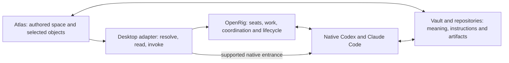

# Atlas and OpenRig integration plan

Planning date: 2026-10-18 America/Guayaquil. Documentation only. This is the coordinator's proposed integration plan; implementation is not authorized. [WORKING.md](WORKING.md) remains the concise entry point.

Follow-up: the owner's ontology correction and the independent revised attempts are synthesized in [ontology and labeling](ontology-synthesis.md). That synthesis supersedes this plan's resource/home-centered framing and delivery order. The capability survey, transport findings and original comparison below remain useful at their recorded baselines. Owner authorship includes delegated agent authorship; native change and authored map change may both be dynamic.

## Product outcome and freedom contract

Atlas becomes an editable spatial workspace for understanding and operating a real OpenRig environment. The owner and their delegates choose and evolve the map, imagery, names and arrangement. Integration attaches useful entrances and explicit interpretations to selected objects. An agent, role, repository, task, artifact or collection of knowledge can have several representations without becoming several underlying resources.

The main journey is: select an existing object, discover its home and purpose, reach the current native colleague, ask a question or create owned work with relevant context, continue freely through native tools, then return to an Atlas view that reflects the resulting team and work. Atlas can close throughout that work. No compulsory map, workflow, governor, task state machine or transcript viewer sits between the person and the native environment.

Preserve these properties across every delivery slice:

- OpenRig remains authoritative for seats, membership, lifecycle, supported coordination and owned work. Operations outside Atlas remain valid and discoverable.
- Codex and Claude Code retain their native conversation, repository instructions, skill/tool discovery, approval behavior, model configuration and temporary subagents. Helpers need not become persistent seats or tokens.
- Atlas owns presentation, spatial navigation, local objects and their history. Vault/repository sources retain their own authority for meaning, knowledge, code and instructions. Links compose those sources without copying a second doctrine into the map.
- A missing dedicated control leaves the native capability reachable. Known operations can gain useful Atlas controls over time; neither MCP's current tool list nor a fixed object union defines the capability ceiling.
- Ordinary layout edits retain ordinary Atlas semantics. A project may later configure an explicit gesture to invoke an operation. An external action returns its actual result and is not reversed by map undo.

These are long-term product requirements. They do not authorize implementations, permission changes or automatic dispatch in this documentation task.

## Capability map and gaps

Baseline: Atlas `54e43d57b4839e977609fbff4352e7e17cb86c28`, OpenRig source `63db591720e7881ab1b2205d4295bc6ba516295f`, installed OpenRig 0.6.10 build `3001cc436656c435e54425443e708e3e2d8c7d68`. Public feature pages are discovery aids; inspected installed contracts and live observations carry narrower evidence. Source keys resolve under [sources](#sources).

| OpenRig capability | Existing Atlas fit and present support | Missing bridge | Authoritative owner and intended access |
| --- | --- | --- | --- |
| Persistent seats and changing occupants | Plain tokens, selected-object inspector, historical seat/session/generation fields. [A1](#sources) | A live resolver from instance/rig/stable node to current occupant, address and native conversation. Preserve missing/vacant/replaced states. | OpenRig owns the seat; native harness owns the conversation. A first-class native entrance must resolve current state. |
| Dynamic teams: grow, expand, adopt, bind, remove | Existing objects can represent any chosen colleague; no live roster integration exists. | Discover native changes, offer unrepresented resources, support explicitly delegated placement/curation, and qualify corresponding controls. | OpenRig owns membership. The owner or authorized agents decide how it is represented. Native growth works from the first slice; dedicated forms arrive later. |
| Mixed harnesses, models, tools and temporary subagents | Recorded agent card already has purpose, harness/model, repository and cwd. | Current configuration and provenance; links into native settings/tools. No forced helper registration. | OpenRig and harness configuration remain authoritative. Preserve native configuration access; add selected model/configuration controls only against verified contracts. |
| Direct messages, chatrooms, broadcast and historical ask | Selected tokens/text can identify a recipient; Atlas has no message transport. | Recipient/context composer, actual delivery/held/prompt outcomes, and history-search results. | OpenRig owns communication. First-class ask/message; broadcast shows its scope. Historical `ask` and explicitly waking a seat are distinct operations. |
| Owned queue, claims and handoffs | Work text cards and inspector show recorded ownership, lineage and artifact links. | Current queue projection, create/inspect controls and qualified handoff/claim actions with a legitimate actor. | OpenRig's queue remains the only work ledger. A closed row is not an attributed acceptance verdict. |
| Optional workflows, missions and slices | Scenes can arrange steps and related work; they execute no workflow. | Link existing instances/frontiers and qualify useful controls or native entrances. | OpenRig owns execution. Messaging and queue-only collaboration must remain usable without creating a workflow. |
| Addressed context, role homes, skills and plugins | Note pins open home notes and headings; a prepared role-home trial succeeded. A plain token has no generic home-note field. [A2](#sources) | Generic resource/home entrance, addressed-context navigation and deliberate reference/snapshot attachment to work. | Vault owns authored meaning; repositories own instructions; OpenRig owns context composition and managed loadouts. Preserve native skill/plugin surfaces, including unsupported-in-Atlas extensions. |
| Continuity, recovery, handover and fork | Recorded checkpoints preserve historical identity without replacing layout. | Current continuity/recovery information, native routing and later qualified lifecycle controls. | OpenRig/native harness own recovery. Opening a view does not implicitly restart a seat. Duplicating a token does not fork an agent. |
| Events, outside changes and operational history | Per-view stores and a historical inspector exist; there is no live client. | A shared resource cache, freshness, snapshot reconciliation, bounded polling and verified event invalidation. | OpenRig owns operational facts/history. Atlas owns the projection and never persists live status into the map's undo history. |
| Artifacts, evidence and decisions | Inspector has pinned artifact links, digests and attributed historical acceptance. | Resolve actual source/artifact references and current work/proof relationships. | Files/repositories and existing review/proof owners retain authority. Open the source; preserve actor, time, revision and uncertainty. |
| Native terminal navigation and attention | Agent cards offer opening instructions; there is no launcher. | Capability/provider-aware focus, client switch or visible terminal opening, with absent/degraded outcomes. | Native tools own the conversation and approval prompt. A request to open is not proof it opened. See [native entrance](#native-entrance). |
| Multiple hosts and project configurations | Scenes/collections, assets, copies and independent object IDs already exist. | Explicit host/instance binding, remote-native access, project membership and shared-reference versus copy/rebind semantics. | OpenRig owns registered host routing; project authors own scope. A daemon connection alone does not provide remote interactive terminal access. |
| Relationships and permissions | Authored labels/routes and player presentation can express meaning. | Clearly distinguish declared relationships, current runtime facts and actual permission controls. | Existing policies/native approvals enforce authority. OpenRig edges are not general communication ACLs; Atlas visibility is not agent access control. |
| Human map authoring, copy/delete, undo and command scope | Native assets, tokens/text/pins, stores, persistence and history work. Studio commands already check scene ancestry. [A3](#sources) | Optional live bindings in normal objects; generic selection/capability-scoped commands instead of studio-specific checks. | Atlas owns local authoring. Keep unbound objects ordinary; preserve unknown optional fields through save/copy. No character mechanics are required for colleagues. |

The largest gaps are local Atlas integration work: resource binding, current-state resolution, shared projection, native navigation and supported action adapters. Upstream/installed limitations include incomplete event coverage, no general capability manifest established, and provider-dependent per-seat navigation. A lack of a polished Atlas control is a delivery choice, not proof that OpenRig lacks the operation.

## Minimal integration architecture

Use deterministic code for transport, identity resolution, projections and command mechanics. Existing agents retain judgment and native working loops. No new agent primitive or mandatory coordinator service is needed. An optional caretaker continues to receive ordinary bounded OpenRig work; it does not become a gate for normal human editing or every click.

Proposed ownership and connection paths:

### Bindings and authored state

Keep immutable `recordingReference` historical. Propose a separate optional external-resource reference and optional home-note entrance for selected ordinary objects. A minimal reference needs a configured connection/instance key, a namespaced resource kind and an opaque stable resource ID, with rig/node coordinates where that operation requires them. Endpoints, credentials and local executable paths belong in local connection settings, not exported scene files.

Scene object, image asset, role/home note, seat, occupant generation, native conversation, queue item and artifact revision remain distinct. Several objects or scenes can reference one resource. A same-named replacement is not the old seat. A role that outlives its occupant can have an explicit role-to-seat link, including vacancy, without requiring a global organization schema.

Reuse native creation, selection, copying, reference traversal, persistence and history. Runtime updates must not overwrite labels, artwork or positions. Unknown fields/kinds remain preservable and inspectable; unsupported operations retain native/source navigation. Bind only selected meaningful objects. Painted scenery requires no software entity.

### Connection, compatibility and extension

Start inside the desktop plugin with supported daemon HTTP reads/writes and a narrow local CLI/native-surface adapter where needed. This avoids another background service before evidence requires one. Verify Obsidian origin, request and streaming behavior against the configured daemon. Preserve its host/origin and authorization boundary rather than weakening it to make an initial request succeed.

Use build identity from `/healthz` where available, an explicitly configured installed CLI where necessary, and operation-specific non-mutating response validation. `/api/info` currently identifies the installation root; it is not a feature manifest. A small tested compatibility table can classify each operation as supported, unavailable or unverified. Version strings alone do not prove behavior.

Current MCP registers 18 tools and omits major queue/context/recovery/event surfaces. It may be one transport, not the exclusive integration. Do not invent complete capability discovery or generate executable buttons from arbitrary metadata. New native capabilities remain usable through native access while their Atlas adapters are added deliberately. Unknown fields must not crash or disappear on an unrelated save.

### Current state, freshness and history

Use one client/cache per configured connection, shared across views and keyed by resource identity. Atlas view stores continue to hold authored scene state. A minimal current lookup supports the first native entrance; broader shared projections follow in slice 2.

Take scoped inventory/work snapshots on connect, focus/return, command completion and reconnect. Bounded polling remains the correctness baseline. Add events as invalidations after qualifying the stream. Subscribe/buffer before initial reads to avoid a race, deduplicate sequence numbers, and refresh authoritative records rather than infer transitions from token positions.

In installed 0.6.10, rig-filtered `/api/events` can omit queue events lacking `rigId`; `/api/queue/sse` has no replay and excludes `queue.updated`. A global stream can invalidate connected-resource reads, with scope resolved from authoritative data. Do not build a second global event archive or assume retention/reset guarantees. Reconcile snapshots after any uncertain coverage or cursor reset. [O2](#sources)

Show last-observed time and stale/offline/unresolved states. Keep local authoring available offline; require fresh resolution for affected external actions. A partial listing does not establish deletion. Do not silently queue mutations for reconnect. Recorded checkpoints remain explicitly historical, separate from current status and map undo.

### Operations and actor identity

Offer explicit controls for known operations. Resolve the current target immediately before invocation. Attribute the real human/integration actor or managed seat according to the supported contract; never impersonate the selected colleague. A declared source label remains declared provenance. If a write requires a managed actor unavailable to Atlas, route to the supported native operation or an explicit request to that actor.

Return the native result, including held delivery, prompt refusal, partial terminal opening and authoritative work IDs. Keep submission, delivery, claim, completion and acceptance distinct. A small local operation receipt can record target, actor, time, parameters/reference digest and returned IDs for diagnosis; it is not another task ledger. After an ambiguous timeout, inspect the effect before retrying. Reuse a supported idempotency identity where available, and never assume every mutation has one.

Map undo covers local placement/content/binding edits. Reversing an external operation requires a separately supported compensating action. Saved map content must not become an arbitrary shell command. Native CLI invocations use validated operations/arguments from trusted adapter code and local settings.

### Native entrance

Preserve a native route from the first useful slice. Installed terminal APIs compose rig/pod/saved views; visible desktop window opening also involves CLI-side behavior. `seat switch-client` needs an attached tmux client. The node focus route needs a bound cmux surface. These are useful existing pieces with different prerequisites, not a universal per-seat desktop URI. [O3](#sources)

Prefer exact provider-backed focus when the binding is known and qualified. Otherwise expose the actual supported result, for example **Open team terminal**, with the target colleague identified. Keep **Open agent** as the intended experience and qualify the adapter needed to reach that exact current conversation. Missing clients/providers and stopped occupants receive explicit native/recovery routes. Opening never silently launches or replaces a seat. Remote HTTP reachability without interactive access is a distinct degraded state.

### Shared context and project reuse

Use existing home notes, addressed sections, repository instructions and OpenRig context composition. A map exposes reading routes; it does not duplicate complete instructions or stream every pointer movement into an agent. Deliberately publish meaningful context revisions, preserving what was actually attached to past work. Availability/delivery and observed consumption remain separate facts.

Keep project configuration small until a second real scenario needs a shared contract. An Atlas collection is not automatically a rig or project. Notes already provide broad navigation; scene-pin links are currently collection-local. Cross-project navigation should use an explicit note/scene entrance or an intentionally qualified collection switch, without relaxing game collection rules globally. Export/import must distinguish sharing a resource, copying a representation/configuration, and rebinding a local connection. Missing hosts and sources remain unresolved until deliberately rebound.

## Phased delivery

Every row below is proposed work, not current authorization. The interface can grow without limiting native operation between slices.

| Slice and dependency | Deliverables and source seams | Acceptance evidence before claiming the slice |
| --- | --- | --- |
| 1. Resource entrances and native access | Optional binding/home-note contract; selection inspector/context action; rename/copy/persistence support; minimum current identity lookup and qualified native opening. Reuse `types.ts`, `RecordedWorkspaceOverlay.tsx`, `FileReferenceService.ts`, `renamedPaths.ts`, `MapPersistence.ts` and native terminal contracts. | Bind two existing objects to one resource, including another scene. Move, duplicate, delete/undo and reopen; references survive and no external resource is copied/deleted. Rename a home note. Replace an occupant outside Atlas; opening resolves the current conversation or explains the missing route. Preserve the owner's artwork/layout. |
| 2. Live operational picture; extends 1 | Shared connection store, inventory/queue readers, current inspector, roster discovery, freshness/reconciliation. Start bounded polling; qualify SSE separately. Reuse view subscriptions without coupling live state to history. | Grow/adopt/remove outside Atlas and observe convergence without auto-placing or moving objects. Test missed `queue.updated`, reconnect, daemon restart/cursor reset, partial lists, same names on different hosts and offline authoring. Map undo cannot restore an old runtime status. |
| 3. Useful collaboration; requires 1 and 2 | Message/history-search/context composer, create/inspect owned work, qualified handoff/claim, artifact and evidence navigation. Reuse upstream transport/queue/actor contracts. | From an authored role home, ask a real colleague, create owned work, follow an actual handoff and open its artifact. Verify actor provenance, prompt refusal/held delivery, uncertain timeout and no duplicate retries. Continue in native tools and return to correct Atlas state. A completed row without a review remains unaccepted. |
| 4. Evolving teams and optional workflows; requires reliable state/results | Capability-backed grow/adopt/remove, supported model/configuration/lifecycle controls, continuity/fork entrances and optional workflow views. Each operation gets its own adapter and proof. | Native and Atlas membership/configuration changes reconcile. Removal with active work follows the native fallback/refusal rules. Fork creates a new external identity; token duplication does not. A complete queue-only journey succeeds without a workflow. Native tools/subagents remain unrestricted by Atlas representation. |
| 5. Shared context and project/host reuse; follows a proven local journey | Addressed reading routes, meaningful context publication, explicit share/copy/rebind/export semantics, host-aware native entrances and optional delegated caretaker work. Reuse existing notes and collection transfer mechanisms. | A fresh native session discovers home, canonical instructions/skills, relevant accepted decision and current obligation. Copy representations while sharing a seat; explicitly copy/rebind configuration separately. Missing dependencies, an unknown extension and a remote host without terminal access degrade honestly. Two project arrangements coexist without a prescribed template. |

Context is useful from slice 1 through home notes and from slice 3 through explicit work attachments. Slice 5 generalizes publishing, discovery and reuse rather than postponing all agent-readable meaning until the end.

The release test combines the slices: begin in Atlas, change the team and do substantial work in native OpenRig/Codex/Claude Code, close/reopen Atlas, and find current ownership, context and results with the authored map intact. Test a capability with no dedicated Atlas button through the native route. This is the principal test against unwanted limitations.

Future implementation should add focused behavior tests plus touched-package lint/typecheck, then exercise real Atlas/native journeys in an isolated vault. Reuse relevant recorded editing/overlay tests while adding failure cases for live identity, freshness and effects. Source tests, actual provider operations, visible UI success and owner usability acceptance remain separate claims. Full CI remains the repository gate where configured. None of these implementation tests ran for this documentation change.

## Independent attempts and synthesis

The owner requested independent Astra and Opus 5.5 attempts through OpenRig. Both received the same [planning brief](integration-planning/2026-10-18/brief.md), launched in the Atlas planning worktree at baseline `54e43d5`, and owned separate files. Neither was assigned to read the other's attempt. The external Codex coordinator owns this comparison and the final plan; author completion is not peer acceptance.

Original outputs are preserved as authored:

- [Astra proposal](integration-planning/2026-10-18/astra.md), `gpt-6-astra`, seat `planning-astra@atlas-integration-repos`.
- [Opus 5.5 proposal](integration-planning/2026-10-18/opus-5.5.md), `claude-opus-5-5`, seat `planning-opus@atlas-integration-repos`.

The proposals converge on stable references, a shared live projection outside map history, native harness freedom, explicit operations and no new agent primitive. Astra is more precise about freshness, incomplete event coverage, result semantics and installed-versus-proposed support. Opus develops a stronger concrete interaction model, especially the unrepresented-seat tray, command scope and native UI entrances. Neither proposal is adopted wholesale.

| Decision | Astra's attempt | Opus 5.5's attempt | Coordinator synthesis and reason |
| --- | --- | --- | --- |
| Historical versus live references | Keep immutable recordings and live resource bindings separate. | Generalize `RecordingReference` through a backward-compatible union. | Keep a distinct live reference with explicit compatibility for old recordings. An immutable evidence locator must not silently acquire live meaning. |
| Transport | Supported HTTP reads/mutations, CLI/native adapter where needed. | HTTP reads, installed CLI for every operational action. | Choose per operation. Use the supported contract that preserves behavior and actor provenance; reserve CLI/native adapters for required semantics. Do not require all writes to use one transport or assume every CLI verb has equivalent JSON/preview behavior. |
| Freshness and events | Snapshot polling is the baseline; qualify SSE separately. | Global SSE plus invalidation and reconnect snapshots. | Keep bounded snapshot reconciliation and add global SSE invalidation where qualified. This covers missing queue updates, reconnects and uncertain retention without another operational ledger. |
| Native opening | Distinguish team terminal opening from unverified exact seat opening. | Also identifies cmux node focus and native attach/client-switch pieces. | Use existing provider-specific focus where valid, otherwise label the real supported fallback. The remaining gap is an exact, current, visible native entrance, not an absence of all terminal access. |
| Unrepresented colleagues | Discover seats and let the owner decide whether to represent them. | An Unplaced tray provides a concrete entrance. | Adopt an optional unrepresented-resource list/tray. It may reuse shared indexing/subscription/search patterns; it must not auto-place seats or force agents through creature/statblock mechanics. |
| Shared context | Home/reference links first; general publishing/reuse later. | A later scene/selection context export phase. | Context starts with existing home notes in slice 1 and explicit attachments in slice 3. Slice 5 generalizes publishing and reuse. Publish authored meaning and addresses; do not turn a screenshot or every geometry change into mandatory context. |
| Operations and extra gates | Incremental controls under legitimate actors and native semantics. | Narrow Send/Assign first; later lifecycle forms all previewed and confirmed. | Narrow controls are sequencing. They must not become a permanent messages/queue-only ceiling. Use previews where supported and retain existing native authority/approval behavior; do not add a blanket second approval or promise every verb has a dry-run. |
| Attested human actor | Qualify each route's actual actor/provenance requirements. | Calls out declared `claimed:v1` attribution and proposes upstream attestation. | Show current provenance truthfully and never impersonate a selected agent. Qualify supported declared-human operations or route to native actors. A new human-identity system is not a prerequisite for read/native-navigation slices. |
| Relationships and future gestures | Permit deliberate supported operations with clear effects. | Keeps drawn relationships descriptive and operational edges in native specs. | Ordinary drawing remains authored meaning. Future explicit topology/gesture controls may delegate supported native changes. Do not infer ACLs or turn today's scope into a permanent prohibition on such controls. |
| Compatibility evidence | Inspects specific installed contracts and documents uncertainties. | Adds route/tool inventory counts and favors the native CLI as the operational surface. | Use operation-specific contract checks. Equal route counts, a version string or a native command catalog do not establish behavioral parity or a complete executable capability schema. |

### Planning-run evidence and limits

Both were actual provider-backed OpenRig seats in the existing `atlas-integration-repos` rig, not native helper subagents presented as seats. The two owned assignments were independently claimed. The coordinator inspected native Codex turn-context model fields and Claude assistant-record model fields and observed the requested model names; these are native-record observations, separate from configuration and author self-report. Raw provider conversations and daemon databases remain private.

Both assignments are now `done/no-follow-on`: `atlas-integration-plan-astra-20261018` and `atlas-integration-plan-opus-20261018`. Each author's closure note records its artifact path and digest. The runtime does not allow the dedicated evidence field on this terminal transition. This establishes author completion, not peer acceptance of the final synthesis.

| Preserved input/output | SHA-256 |
| --- | --- |
| Common brief | `986d9670d3c476fc38b9270550c4033eb9fde158a2efd7442d14b04a6514798b` |
| Astra original, 2,506 words | `bd6cfdca10ddddb0388d3061011e34f8f9c3cb1a3cfb6127b8ed4e467d1d417f` |
| Opus 5.5 original, 3,153 words | `908a952fb80ba4b1c02224fe8ff3a08245773b08ac26d655e1e61713e12d553f` |

The pod expansion CLI timed out after five seconds with an unknown outcome. The coordinator checked the authoritative inventory and native panes, found both seats running, and did not repeat the mutation. The Opus task's initial nudge was refused at an ordinary approval prompt; the task persisted and the seat later discovered and claimed it. These observed differences between request, delivery and actual work reinforce the operation-result requirements above.

Ordinary one-time approvals covered the actual displayed reads and document checks. No auto mode, persistent command allowance, API-key billing or permission bypass was introduced. The two authors owned only their proposal files; the coordinator owned the working document, source verification and synthesis. Originals remain independently useful documents, including their own uncertainty and evidence classifications. They are not rewritten to imply acceptance of this synthesis.

After both authors completed, snapshot `01M58TB577CJFY9DNKMD3ETNPJ` preserved the run. Only the temporary `planning` pod was retired. The two pre-existing repository representatives remained running in their original roots. Launch-generated guidance and the collector were preserved privately, then the planning worktree's canonical `AGENTS.md` and `CLAUDE.md` were restored exactly. They are not part of this documentation diff.

Verification for this change is documentation/source-link/style/diff checking, the actual owned-work lifecycle, and native model metadata. No product code, native Atlas vault or live connector was changed or qualified. The plan remains incomplete as a product until the proposed behaviors are implemented and exercised through their real consumers.

## Sources

Atlas links point to source in this tree, inspected at the baseline above. OpenRig links are pinned to its inspected checkout; installed JavaScript counterparts were separately checked. Proposal/interface existence does not establish a tested Atlas integration.

- A1: [object types](../../src/app/types.ts), [recording types](../../src/app/agent-workspace/recordingTypes.ts), [recorded bindings](../../src/app/agent-workspace/recordedSceneBindings.ts), [selection overlay](../../src/app/agent-workspace/RecordedWorkspaceOverlay.tsx), [inspector](../../src/app/agent-workspace/RecordedWorkspaceDetails.tsx).
- A2: [vault and roles](vault-and-roles.md), [role-home trial](vault-homes/verification.md), [file references](../../src/app/services/FileReferenceService.ts), [rename traversal](../../src/app/services/renamedPaths.ts), [scene links](../../src/app/services/sceneLinks.ts).
- A3: [command scope](../../src/app/agent-workspace/registerRecordedWorkspace.ts), [view store](../../src/app/storeFactory.ts), [persistence](../../src/app/services/MapPersistence.ts), [history](../../src/app/stores/history.ts), [object actions](../../src/app/stores/mapObjectsSlice.ts), [recorded editing tests](../../tests/unit/recordedSceneEditing.test.ts).
- O1: [OpenRig route mounts and build identity](https://github.com/fsafey/openrig/blob/63db591720e7881ab1b2205d4295bc6ba516295f/packages/daemon/src/server.ts), [inventory](https://github.com/fsafey/openrig/blob/63db591720e7881ab1b2205d4295bc6ba516295f/packages/daemon/src/routes/ps.ts), [queue and actor contracts](https://github.com/fsafey/openrig/blob/63db591720e7881ab1b2205d4295bc6ba516295f/packages/daemon/src/routes/queue.ts), [MCP subset](https://github.com/fsafey/openrig/blob/63db591720e7881ab1b2205d4295bc6ba516295f/packages/cli/src/mcp-server.ts).
- O2: [global event replay](https://github.com/fsafey/openrig/blob/63db591720e7881ab1b2205d4295bc6ba516295f/packages/daemon/src/routes/events.ts), [queue events/watch](https://github.com/fsafey/openrig/blob/63db591720e7881ab1b2205d4295bc6ba516295f/packages/daemon/src/routes/queue.ts), [foundation connector observations](https://github.com/fsafey/openrig/blob/63db591720e7881ab1b2205d4295bc6ba516295f/docs/reference/foundation/connector-outline.md).
- O3: [terminal API](https://github.com/fsafey/openrig/blob/63db591720e7881ab1b2205d4295bc6ba516295f/packages/daemon/src/routes/terminal.ts), [desktop CLI opening](https://github.com/fsafey/openrig/blob/63db591720e7881ab1b2205d4295bc6ba516295f/packages/cli/src/commands/terminal.ts), [cmux node focus](https://github.com/fsafey/openrig/blob/63db591720e7881ab1b2205d4295bc6ba516295f/packages/daemon/src/routes/sessions.ts), [tmux client switching](https://github.com/fsafey/openrig/blob/63db591720e7881ab1b2205d4295bc6ba516295f/packages/daemon/src/routes/seat.ts).
- Official discovery/orientation: [feature map](https://openrig.dev/features), [addressed context](https://openrig.dev/docs/context), [edge semantics](https://openrig.dev/specs/edge-types), [context as world building](https://openrig.dev/blog/how-my-agent-teams-find-their-way). Some concept pages declare a 0.6.6 baseline; qualify against the actual installed build before implementing.
