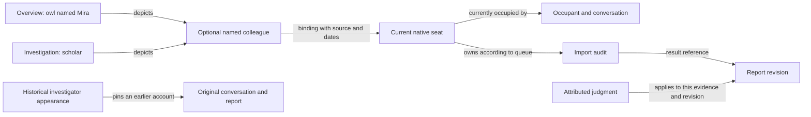

# Atlas and OpenRig: shared ontology and labeling synthesis

Date: 2026-10-18 America/Guayaquil. Coordinator synthesis of the independently authored [Astra report](integration-planning/2026-10-18/ontology-astra.md) and [Opus 5.5 report](integration-planning/2026-10-18/ontology-opus-5.5.md), under the [revised common brief](integration-planning/2026-10-18/ontology-brief.md). Proposed design for review, not an accepted schema or implemented integration. [WORKING.md](WORKING.md) remains the concise entry point.

## Recommendation

Represent one evolving world of participants, purposes, resources, places, actions and consequences. Give its relationships an explicit meaning and its accounts a source, scope and time. Atlas can express that world through characters, parties, quests, places, clues and encounters while retaining each native system's actual identities and rules. Maps and tokens can be replaced, transformed or regrouped by people or delegated agents without changing the meaning or history of their subjects.

Combine Astra's minimal shared grammar and contextual roles with Opus's rule that a label must attach to the thing it is actually true of. Keep Opus's durable persona as an optional authored identity when a recognized colleague needs continuity across seats. Use explicit interpretation and evidence to connect that identity to current or historical native work. Neither a persona registry nor an RPG character sheet is required for native participation.

This is a substantive revision of the earlier [integration plan](integration-plan.md). References remain necessary, but a reference alone does not explain what a representation means or why its account should be believed. The next design unit is a complete, changing colleague/work/result journey, rather than a fixed map of resource launchers.

## What each agent produced

| Attempt | Shared ontology | Labeling model | Strongest contribution |
| --- | --- | --- | --- |
| [Astra, full report](integration-planning/2026-10-18/ontology-astra.md) | Someone acts toward something, in a situation, using something, with a consequence. Participant, undertaking, situation/resources and occurrence/consequence are questions, not required record classes. Roles are scoped relationships. | Human name, referent, interpretation, type/role, and state/grounds. Distinguishes an exact subject, current-seat follower, historical account and aggregate. | Explains why linking to a seat is insufficient, keeps changing representations open, and connects claims to existing native proof judgments. |
| [Opus 5.5, full report](integration-planning/2026-10-18/ontology-opus-5.5.md) | Actor, undertaking, artifact and place, connected by relations and qualified accounts. Actor analysis distinguishes calling, persona, seat, occupant, conversation and transient helpers. | Attach a mark to the layer it describes; retain source, basis, time and standing. A persona can preserve recognized continuity through a binding history. | Makes cross-seat continuity concrete, attaches labels to the right subject, and uses RPG affordances to express attention, perspective, groups and consequences. |

Both materially revise their first attempts. Both now permit delegated scene authorship, distinguish appearances from native subjects, use accounts with provenance, and reject compulsory token/seat registration for native helpers. Both use the current planning run as a counterexample to identifying a colleague by an address: the old planning nodes were removed, the address was reused, and the new conversations were forks.

## Comparison and synthesis

| Issue | Astra | Opus 5.5 | Synthesis and reason |
| --- | --- | --- | --- |
| Essential shared ontology | A small grammar of action in context; avoid mandatory new classes. | Four continuing things plus actor layers, representations, accounts and relations. | Use the grammar to define meaning and Opus's distinctions to check examples. Do not turn their combined nouns into a larger universal schema. A result can become a resource in later work; a place may be native context or an authored location. |
| Roles and recognized colleagues | Roles are contextual participation; name a role separately only when its continuity matters. | A calling/persona can sit above the native seat and hold cross-seat binding history. | Contextual roles by default. Allow a named colleague/persona or role note when people need that continuity, with explicit bindings and grounds. No compulsory calling-to-persona-to-seat chain or one-to-one cardinality. |
| Label attachment | Referent plus interpretation, scope and grounds. | Attach the label to the most durable layer where it remains true. | Attach each claim to its correct subject, then state its scope/time and how the appearance follows it. Durability is a useful check, not a reason to attach a claim to a more permanent but wrong thing. A local alias need not rename a persona or native seat. |
| Many scenes and snapshots | Current, exact and historical appearances can differ deliberately. | Tokens sharing a persona show the same observations; old scene snapshots re-read current native state. | Equal subject, interpretation, source scope and time should agree. A current view and a historical view may differ. Pin historical accounts to an immutable source/revision; never restore old live status through scene undo. A snapshot must state which meaning it preserves. |
| Accounts and acceptance | Uses observed facts, authored claims, inferences and attributed judgments; identifies installed revision-sensitive proof. | Makes source/basis/time/standing explicit and asks where judgments live. | Keep these dimensions separate. Where configured, reference native proof judgments and their revision/evidence checks. Elsewhere use attributed accounts or existing decision notes. Observation, freshness, disagreement and acceptance are not one status enum or a truth score. |
| Authority of relations | Different relations and accounts have their own sources, scope and contestability. | Each relation has one authority; native authorities decide facts, owner settles meaning. | Name the authoritative source for each native operation or field and the author/remit for each interpretation. Competing accounts of the same relationship can coexist. A native projection can be stale or instrumentally wrong; provenance does not make it infallible. Meaning can have delegated owners. |
| Dynamic board authorship | Delegation can include creation, layout, artwork, regrouping and removal, with conflict handling. | Delegated edits within a remit; recommends each seat editing its own representations. | Remit comes from the owner. Own-representation editing is an example, not a product ceiling. A caretaker or other delegate may curate a whole scene, including redesign, if authorized. Preserve concurrent human intent rather than requiring approval of every move. |
| Native capability and actions | Supported per-operation adapters, native access throughout, no blanket extra approval. | CLI verbs, target confirmations, spatial gestures at most propose an action. | Keep ordinary drawing separate from operational effects. An explicit action or deliberately configured gesture may invoke a supported native operation under existing authority. Do not add a mandatory second confirmation to every verb or restrict all operations to one transport. |
| Conversation references | Exact conversations and historical accounts can be first-class referents. | Says conversation IDs should never be displayed or stored because they are resume tokens. | Do not adopt that blanket prohibition. Exact/historical conversation references are needed for this journey. Use supported native references and handle sensitive values according to their contract; keep technical handles in inspection/navigation rather than every nameplate. A field named resumeToken does not itself settle the policy. |
| RPG visual grammar and perspective | Reuse forms while distinguishing actual mechanics from analogy. | Proposes specific observed/declared/inferred styles, attention initiative, summons and GM perspectives. | Keep these as design candidates. Show consequential source/basis/freshness without requiring a badge on every decorative mark. Presentation visibility is distinct from native permissions and evidenced context consumption. Native helpers can be represented through whatever evidence their harness exposes; incomplete OpenRig visibility is not a ban. |

The most useful agreement is that stable meaning does not require stable appearance. The most consequential disagreement is whether recognized identity needs a layer above every native seat. The recommendation is an optional authored continuity identity, justified by the actual use case, with no automatic claim that a successor is the same occupant or remembers the same work.

## Labeling through one concrete example

The owner recognizes a colleague as **Mira**. Mira currently investigates **Import audit**. One overview depicts Mira as an owl, a focused scene as a scholar, and a later harbor map as a ship. These are appearances, not three agents.

| Visible element | What it is about | What connects it | Authority and change rule |
| --- | --- | --- | --- |
| Owl caption "Mira" | This appearance; optionally an independently named colleague | Local alias and an explicit subject reference | Scene author or delegate. Changing artwork/caption does not rename or create a native agent. A shared note can supply a default name without owning every local alias. |
| "Current investigator" | A scoped responsibility or a continuing seat | A declared role relationship or a native custody observation, identified as such | The source that actually owns that relation. If the appearance follows a seat, replacement resolves to its current occupant; an appearance of the original investigator stays historical. |
| "Codex / working" | The currently resolved runtime/activity observation | Native identity, evidence source and sample time | Native projection. It may be stale, unknown or inconsistent with another field. No manual token condition silently replaces it. |
| "Reviews Import audit" | A relationship between a participant and an undertaking | Named endpoints, meaning, scope and basis | Queue custody or an attributed authored account, depending on what was actually established. A drawn line alone does not assign work. |
| "Report accepted" | A particular result and its applicable evidence/contract revision | Artifact reference, evidence and attributed judgment | Configured native proof or the actual review/owner decision source. Changed evidence can make applicability unknown without deleting the old judgment. |
| "Researchers: one needs input" | A specified group at a stated observation time | Explicit membership basis and a visible aggregation rule | Native members remain native facts; the aggregate is a derived account. Resolve the actual recipient set separately before an operation. |

An independent colleague identity, if needed, can have an authored note containing its purpose, role relationships and binding history. The history identifies which seats/conversations were associated, when, why, and on what evidence. It can refer to several concurrent or historical bindings; do not assume a chain with exactly one member at every layer. A native lineage record, provider history and coordinator report have different evidence strength. Preserve whichever exists rather than copying a reported link into a field that claims native attestation.

A meaningful selection answers: what is this appearance; what does it stand for; why is it here; what is happening; how do we know? The inspector or linked note carries most of the explanation. Addressed text exposes those same subjects, relationships, legends and source routes to a native agent. An agent need not infer all of that from a screenshot.

The optional colleague node can be omitted when direct native references suffice. The diagram names relationship meanings, not mandatory record types. Native facts and authored interpretations retain their own sources even when drawn in one view.

## Journey and change cases

| Moment | Atlas handles | Native tools retain | What the label must establish |
| --- | --- | --- | --- |
| Select a colleague | Appearance, context, relationship legend, current/exact/historical interpretation | Actual seat and conversation identity | Is this a role, a recognized colleague, a specific occupant, a group, or a historical account? Missing bindings remain explicit. |
| Open its native session | Resolve the target and use a qualified entrance or honest team-terminal fallback | Real conversation, tools, skills, model, prompts and continuity operations | Which current or exact conversation is being entered. A transcript viewer is not equivalent to native interaction. Opening alone does not restart a seat. |
| Give work | Explicit target/context and supported ask or owned-work operation; useful local representation | Conversational exchange, queue custody, native actor and approval semantics | Delivered, claimed and completed are different outcomes. A conversation need not create a quest or queue row. |
| Follow progress | Sourced observations, navigable accounts and delegated scene evolution | Investigation, tools, subagents, team growth, fork and handoff | What was observed, by which instrument, and how recently; a timer or filled clock does not create proof. |
| Inspect the result | Open the artifact and applicable judgments, show disputed or stale accounts | Artifact authority, evidence, review/acceptance and operational history | Which revision is judged and whether that judgment remains applicable. Owner adoption remains a separate decision. |

Three cases test the same model:

1. **Fork, compaction and replacement.** A fork creates a new conversation with source lineage where evidenced. Compaction does not automatically create a new occupant or subject. A successor may keep a seat; a removed/recreated node may reuse an address without keeping the seat identity. An optional colleague note can recognize continuity across those changes without claiming an exact native resume. A personal promise or historical judgment stays with its original actor. A current-seat appearance follows its stated rule; a historical investigator appearance preserves the earlier reference.
2. **Growth, branching and delegated redesign.** Native work adds specialists and temporary helpers, splits an undertaking and changes membership. An authorized agent turns a library investigation into a harbor map, replaces an individual appearance with a group emblem and creates focused scenes. Explicit group membership and interpretation survive the redesign. The agent's delegation permits those board changes; native operations establish actual seats and work. Decorative placement or encounter spawning does not launch a team. No permanent seat is required merely to depict a temporary helper.
3. **Different perspectives and time.** A current scene follows the latest report while an earlier scene pins revision 1. A skeptical review and an author's completion report remain attributable accounts, even if both refer to the same work. Restoring the earlier board layout does not replay old native operations or reinstate stale live status. Historical evidence may remain pinned; current observations are reconciled separately. A changed proof contract/evidence can invalidate present applicability while preserving the recorded judgment.

These cases keep ontology, topology and epistemology connected: identity and relation meaning survive where their continuity rules say they should, arrangements evolve independently, and each account retains its grounds. They do not require every picture to become a semantic object or every task to follow an RPG sequence.

## Existing features and integration sequence

The [earlier capability map](integration-plan.md#capability-map-and-gaps) retains detailed source seams. The revised attempts inspect Atlas `f5dfe51` and OpenRig checkout `63db5917`, separately from installed OpenRig 0.6.10 build `3001cc43`.

| Existing capability | Useful expression | Missing bridge or important boundary |
| --- | --- | --- |
| Tokens, character note links, nameplates, text and pins | Participants, resources, local concepts, clues and results with several appearances | Generic references and explicit interpretation on relevant objects. Plain tokens have no generic note field. Character/statblock data is not a mandatory agent capability manifest. |
| Scenes, links, hexes, backgrounds and collections | Changing contexts, authored places, multiple perspectives and levels of detail | Explicit legends and addressed scene meaning. Collections are not projects, and current scene links remain within a collection. |
| Encounters, player groups and formations | Reusable groups and spatial arrangements | A formation creates local tokens, not native seats. A pod is a native context grouping, not automatically an RPG party. |
| Conditions, bars, counters, clocks and initiative | Defined observations, authored assessments and optional attention order | Render current native observations outside persisted token state/undo. A clock needs an explicit measure; initiative is not the agent scheduler. |
| Fog, player view and visibility | Presentation and authored perspectives | These do not enforce native access or prove what an agent consumed. Provide context routes and evidence without inventing knowledge from visibility. |
| Recording references, persistence, copy and history | Reusable appearances and explicit historical accounts | Preserve immutable recordings. Add current/exact/authored reference semantics deliberately; copied appearances must not create native resources. |
| OpenRig inventory, queue, context, continuity and native terminals | Actual collaboration and native change, with meaningful Atlas entrances | Shared current resolution, source/freshness, reconciliation and qualified native opening/actions. Current observations remain outside scene undo. |
| Native proof and artifact sources | Attributed, revision-sensitive judgments where configured | Keep receipt authority and evidence scope. General interpretations and meaning disputes still need authored accounts or existing decision sources. |

Recommended later delivery order:

1. **Prove the meaning in one example.** Use existing notes and representations to describe the colleague, undertaking, result, contextual roles and one current/historical distinction. Introduce an optional colleague identity only if that case needs continuity across native subjects. A person and a fresh native agent should recover the same meaning with cited routes. Keep this in documentation until implementation is authorized; do not install a vocabulary into the canonical vault as part of this change.
2. **Complete a native work journey.** Add minimal reference resolution, a current observation channel and native entrance/actions. Ask or assign work, follow native changes, inspect the actual artifact and its judgment. Test reused addresses, vacant bindings, source failure, outside changes and changed evidence. Snapshot reconciliation remains the correctness baseline; incomplete event coverage cannot strand the view.
3. **Make authorship dynamic in both directions.** Provide a supported agent-readable/editable scene surface with attribution, scoped delegation and revision/conflict handling. Demonstrate a substantial scene transformation alongside a human edit and a changing native team. Preserve old references when intended and make rebindings explicit. This precedes a broad catalog of lifecycle forms.
4. **Generalize from exercised needs.** Extend useful aggregates, relationships, local vocabularies, cross-scene/project/host references and selected supported controls. Native helpers, unfamiliar fields and optional workflows remain usable without obtaining a board representation or ontology registration.

Deterministic code should resolve references and execute supported operations. Existing agents can interpret and curate meaning under delegation. No new agent primitive, mandatory ontology server, global identity registry or second task ledger is justified by these reports. The specific badge shapes, attention initiative and place legends remain design choices to test in the complete journey.

## Decisions and limits

The owner has accepted the product aim and the freedom/dynamism requirements. This synthesis recommends a direction; it does not record owner acceptance of its semantic rules or implementation.

The consequential design choices are:

- **Continuity and interpretation:** choose the first example's exact, current-following and historical rules; use an optional named colleague with attributed binding history where direct native identity is insufficient. Decide when changed intent becomes a new undertaking and when a collective deserves its own identity through that example.
- **Authorship remit:** choose which scene an agent can maintain and whether that includes artwork/layout replacement. Recommend one complete investigation scene with ongoing authority and conflict handling, rather than a product-wide own-token-only rule.
- **Evidence and meaning ownership:** choose the claims the example needs and their actual sources/judges. Prefer existing native proof where configured and attributed notes elsewhere. Do not require a universal acceptance system or epistemic style guide before the journey works.

The reports do not establish live integration, a generic scene-edit API, full native subagent introspection, complete event history, visible per-seat opening in Obsidian, or agent consumption of exported context. Existing source surfaces are opportunities, not tested end-to-end guarantees. Unknown native lineage can be investigated or explicitly reported; a persona label must not conceal it.

## Independent run and verification

Both reviews used OpenRig directly in `atlas-integration-repos`, with separate owned queue items and native providers. The earlier planning nodes had been removed. The new seats were native forks from the original conversations, not exact resumes or fresh models reconstructed only from reports. Both compacted before the revised assignment was delivered. The private preparation records and native logs were retained; they are not copied into this repository.

| Evidence | Astra | Opus 5.5 |
| --- | --- | --- |
| Requested and observed native model | `gpt-6-astra` | `claude-opus-5-5` |
| Current node | `01M58W9VEE8ZY4N05JVT3M2EPN` | `01M58W9VEETETHXK9HSPXDZMJC` |
| Original node | `01M58RZHEHPGWA3E2AP6ETY7VR` | `01M58RZHEH0Y8MRPHNXPSGRFQJ` |
| Assignment | `atlas-ontology-review-astra-20261018` | `atlas-ontology-review-opus-20261018` |
| Compaction evidence | Native `compacted` event before assignment | Native `system.compact_boundary` before assignment |
| Author completion | `done/no-follow-on`, 2026-10-18 20:41 America/Guayaquil | `done/no-follow-on`, 2026-10-18 21:22 America/Guayaquil |

The coordinator inspected OpenRig queue/inventory and native model metadata, read both full reports, and checked the important comparison claims against actual Atlas types/recorded binding code and installed OpenRig proof implementation. Source inspection confirms available contracts, not that a native proof mutation or Atlas integration journey was exercised. OpenRig inventory exposes native resume references/commands; this supports rejecting a categorical conversation-reference ban without publishing raw private histories.

Astra completed first. Opus was paused at a read-only native approval prompt when the owner requested this status check; the coordinator cleared the exact one-time reads and supervised it to completion. Native prompts were not replaced with auto mode or persistent grants. The native fork/managed compaction also left observability gaps: Opus recovered its own map, identity and hold, while its pending restore marker/packet were absent. We verified actual compaction and recovery of the active task; we do not claim a complete managed restore-audit success.

Both full revised reports and both original attempts are preserved as authored. The revised brief is an unchanged copy of the common assignment. The coordinator owns the synthesis and working-document edits; neither author's completion is presented as peer or owner acceptance. Native conversations and the active planning worktree remain available for further human work.

Verification for this change: document/reference/style checks, original/revised artifact digests, exact diff scope, and actual OpenRig ownership/completion records. No application tests or build were needed for documentation-only changes. No connector, schema, runtime permissions, canonical vault, deployment or provider configuration was changed.

### Preserved artifact digests

| Artifact | SHA-256 |
| --- | --- |
| Revised common brief | `52bdf684bbc1390f9276f74adde97f4ffb22e4f995460bca15d63b3a1b0f82c0` |
| Astra revised report | `6819e4566e504a529716cc7025eae95f1fda8e0dd2337b759eef87e3d59e367c` |
| Opus 5.5 revised report | `3938ff7a94ec8e6ae1337302711b0eecc2f6edfa51a2e7dd94b74a47e7388919` |

The revised reports contain 4,723 words (Astra) and 5,338 words (Opus 5.5). Each author's queue closure note names the artifact and digest. Earlier originals remain `bd6cfdca10ddddb0388d3061011e34f8f9c3cb1a3cfb6127b8ed4e467d1d417f` (Astra) and `908a952fb80ba4b1c02224fe8ff3a08245773b08ac26d655e1e61713e12d553f` (Opus 5.5).

### Source routes

- [Astra source map](integration-planning/2026-10-18/ontology-astra.md#source-map) and [Opus evidence and sources](integration-planning/2026-10-18/ontology-opus-5.5.md#11-evidence-unknowns-and-sources) retain independently inspected references and evidence limits.
- Atlas [object types](../../src/app/types.ts), [recorded binding semantics](../../src/app/agent-workspace/recordedSceneBindings.ts), [system preset scope](../../src/app/types/systemPresetTypes.ts), [history](../../src/app/stores/history.ts), [formation capture](../../src/app/encounters/encounterFormation.ts), and [native navigation findings](integration-plan.md#native-entrance).
- Installed OpenRig [proof readiness and judgments](/Users/farieds/.local/share/openrig/0.6.10/lib/node_modules/@openrig/cli/daemon/dist/domain/proof/judgments.js) and [proof routes](/Users/farieds/.local/share/openrig/0.6.10/lib/node_modules/@openrig/cli/daemon/dist/routes/proof.js); inspected `readSliceReadiness`, `recordJudgment` and the actor/revision/evidence checks.
- Pinned OpenRig checkout [native resume references in inventory](https://github.com/fsafey/openrig/blob/63db591720e7881ab1b2205d4295bc6ba516295f/packages/daemon/src/domain/node-inventory.ts#L97) and [continuity/activity types](https://github.com/fsafey/openrig/blob/63db591720e7881ab1b2205d4295bc6ba516295f/packages/daemon/src/domain/types.ts#L521). Installed inventory was separately observed; checkout and running build are distinct.
