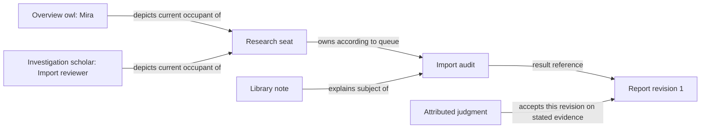

> Captured presentation copy of Astra's own report. Original SHA-256: 6819e4566e504a529716cc7025eae95f1fda8e0dd2337b759eef87e3d59e367c. Repository-relative links are rendered as explicit source locators for this vault copy; the unchanged source is retained in the project sources folder. This report is a proposal, not accepted doctrine.

# Atlas and OpenRig as one working world - Astra

Make Atlas a place where people and agents can understand, arrange and act on the same evolving work. The shared meaning is that participants pursue purposes, use resources, make commitments and produce changes whose consequences can be inspected. OpenRig and the native harness make those actions real; Atlas gives that world visible places, pieces, routes and perspectives. Maps and tokens may change as freely as the work, including through delegated agent authorship. What must survive is knowing what a representation means, what it refers to now or historically, and why its account deserves belief.

Start with explicit references, situated relationships and attributed accounts on existing Atlas objects and notes. Make those useful through one complete native work journey. Do not first build a universal ontology database, another agent runtime, or an RPG ruleset that agents must obey.

This is an independent design proposal under the revised brief (repository source: /Users/farieds/Project/atlas-openrig-integration-workspace/ontology-review-2026-10-18/BRIEF.md), after verified native compaction. It changes my earlier attempt (repository source: /Users/farieds/Project/atlas-openrig-integration-plan/docs/agent-workspace/integration-planning/2026-10-18/astra.md); that document remains historical and unchanged. No peer attempt or coordinator synthesis was read. Examples below are proposed behavior, not implemented integration.

## What changes in my earlier thinking

My first proposal correctly separated map objects from native resources, but treated a resource binding as the central answer. It made fixed role homes and human-selected placement too prominent. That would make a sound launcher while underserving the user's moving, agent-authored world.

The correction is substantive:

- A reference identifies something; it does not explain why it belongs here, what role it is playing, or what a depicted relationship means. Labeling must express that interpretation as well as identity.
- A stable seat is one useful referent, not the organizing atom of every scene. A piece can stand for a team, an undertaking, a specific conversation, a resource, a hypothesis or a proposed future arrangement. A team can have no individual pieces at the current scale.
- Authored does not mean static or human-only. An owner can delegate ongoing scene curation, including creation, movement, regrouping, artwork changes and removal. Persistence must preserve meaning and attribution through those changes, rather than preserve every coordinate forever.
- A home is a contextual destination, not a required one-to-one role-to-seat address. A library can contain several specialists, a specialist can participate in several places, and a temporary expedition can have no permanent home.
- Acceptance already has a stronger native surface than my earlier report emphasized: installed OpenRig has evidence-backed, revision-sensitive proof judgments. Use that where configured; do not substitute an Atlas completion badge. [O3](#source-map)

## The smallest useful shared understanding

The common grammar is: **someone acts, toward something, in a situation, using something, with a consequence**. Both RPG play and agent work require these distinctions. Their concrete types and governing rules differ.

| Essential meaning | In tabletop play | In native agent work | What remains meaningful through change |
| --- | --- | --- | --- |
| Participant | Character, player, party, faction | Human, agent occupant, team; a seat can hold a continuing responsibility | Who participated and in what capacity. A role or membership can change without rewriting earlier participation. |
| Undertaking | Quest, investigation, defense of a place | Request, investigation, queue obligation, project or optional workflow | The intended outcome and its scope. Reassignment preserves the obligation; a changed purpose may require a new one. |
| Situation and resources | Location, encountered objects, clues, equipment, rules | Repository, service, context, artifact, available tools, policies, current conditions | What an action concerns or uses, and the constraints under which it happens. These need not occupy permanent map locations. |
| Occurrence and consequence | A move, discovery, encounter outcome, change in the world | Message, run, fork, handoff, edit, test, result or decision | What actually happened, to which subjects, under which identity and evidence. Later changes do not retroactively change the occurrence. |

These are questions to answer, not four new record classes. An artifact can be an outcome in one undertaking and a resource in the next. A team can act collectively while its members remain separately identifiable. A scene selects a situation for attention; it need not correspond to one rig, repository, workflow or moment in time. An Atlas collection packages assets and shared game settings; calling it a campaign or project does not change its native semantics. [A1](#source-map)

Three distinctions make this grammar usable:

**Identity follows the thing's own continuity rule.** A seat, an occupant, a native conversation, a file revision and a scene appearance answer different identity questions. A role such as reviewer is a relationship between a participant, an undertaking and a scope/time, rather than a permanent species of agent. Give a role its own named note only when people need to discuss that role independently of its holders. Do not create a compulsory role registry.

**Relationships state a meaning, not just proximity.** “Mira reviews the import plan,” “this group contains Mira,” “this note explains the import subsystem,” and “this result supports this claim” are different connections. A line can depict any of them, but must reveal which one, who asserted it and its applicable scope. Being near a workshop may suggest relevance. It does not by itself establish membership, ownership or permission.

**An account is distinct from the world it describes.** A scene, note, transcript, runtime observation or judgment provides an account from a particular source and time. Atlas can depict real work, a retrospective, or a proposed arrangement using the same familiar objects. It must keep those meanings distinguishable when they are mixed. This does not require every decorative tree or freehand mark to have a semantic record.

In this model, ontology gives a relationship its meaning; topology is the arrangement of those relationships and the paths through them; epistemology explains the grounds for believing each account. They meet on an ordinary statement: “Mira currently owns the import audit, according to this queue observation.” The ownership relation is meaningful, its endpoints connect the work, and its source/time qualifies the claim. Moving Mira's piece changes the scene; handing off the audit changes ownership; a stale observation changes what the scene can responsibly say.

The world-building idea is useful because recognizable places and routes let humans and agents find deeper context. OpenRig's [context engineering article](https://openrig.dev/blog/how-my-agent-teams-find-their-way) argues for that navigability and explicit source authority. It does not supply an implemented Atlas ontology or prove that map geometry is understood by an agent. Provide addressed text alongside the board so both participants can recover the same connections.

## Labeling as an explicit interpretation

On selection, a meaningful element should answer five ordinary questions: **What am I looking at? What does it stand for? Why is it here? What is happening? How do we know?** Most of that belongs in the inspector or linked note, not in a crowded nameplate.

Consider an illustrative owl labeled **Mira** in a project overview. Its inspector might say: “Represents the current occupant of the Research seat; reviewing Import audit; native activity: working, observed 12 seconds ago.” An adjacent route labeled **Reviews** links to the audit and its source. A second scene can depict the same seat as a scholar named **Import reviewer**. Both appearances resolve to the same native seat, while their captions and purposes differ.

| Layer of meaning | Concrete rule |
| --- | --- |
| Human name | The author chooses a caption or alias. Renaming Mira to Archivist changes an appearance unless an explicit rename operation targets another source. Native names remain available for disambiguation. |
| Referent | A binding identifies the source and kind: a native seat, exact conversation, queue item, artifact revision, local concept note, or explicit group. Host/instance and resource identity matter; caption, icon, image path and coordinates never suffice. |
| Interpretation | State whether the piece depicts that exact thing, follows its current occupant, depicts a frozen account, or summarizes a specified group. “Current Research seat” and “Mira's original investigation” cannot silently share the same target rule. |
| Type and role | Native type comes from its source. An authored role states a relationship in a scope, with its author or source. “Reviewer” on a badge does not make the occupant an authorized proof judge. |
| State and grounds | Distinguish native observation, authored claim, inference and recorded judgment. Include applicable revision/time and evidence route when consequential. A manual condition named Working is an author's annotation, not runtime telemetry. |

One native thing can have many appearances. One aggregate appearance can summarize several things. An aggregate must expose its membership basis: an explicit set, a native pod, or a declared query whose current results are shown. Such a query is a proposed integration feature, not an existing Atlas capability. Executing an action requires resolving a concrete target or explicit recipient set; clicking a group must not silently broadcast to whoever happens to match later.

Different things may share a name, portrait, role and even a session address at different times. They remain distinct by origin and native identity. Recreating a removed node under the old address must not silently revive its former binding. Copying a piece normally creates another appearance of the same referent; creating another native agent is a separate operation with a returned identity. Copying a complete scene preserves its references unless the author deliberately requests a new hypothetical scenario or rebinding. Export to another installation must show unresolved references instead of matching names automatically.

Identity is not always available. A native temporary subagent may be visible only in a harness result or run record. Preserve that bounded reference or an attributed description, and say what cannot be resolved. Do not mint an OpenRig seat to make every participant fit the display. Similarly, a vault note path is a locator with rename behavior, not a universal permanent identity; durable local concepts need an explicit identity convention only when cross-scene reuse demands it.

**Who may change the meaning?** The scene owner and their delegates may author captions, placement, local concepts and interpretations within their granted scope. A native read adapter reports native facts with provenance. An agent can propose or author relationships according to its delegated remit; its prose does not acquire native authority because Atlas displays it. Native tools determine whether an operational edit is permitted. Domain owners settle disputed meanings; selected judges record acceptance when a proof policy exists. Anyone with the appropriate existing collaboration route can challenge a claim. Keep the challenge and its grounds visible rather than replacing both positions with a single status color.

Agent authorship needs a supported editing surface and conflict handling, not a second map curator service by default. A delegated “maintain this investigation scene” operation should reference the current scene revision, its allowed scope and the observations motivating the edit. If a person changes the same representation meanwhile, preserve both intents for reconciliation. Those capabilities are gaps today. Owner delegation can be ongoing; it need not require approval of every token move.

## The colleague journey

The following is one hypothetical journey throughout, using Mira and an **Import audit**. Existing Atlas affordances are distinguished from the integration behavior being proposed.

1. **Choose a colleague.** The owner opens an illustrated project map. A library pin opens the subsystem note; selecting Mira's owl reveals what it represents, current responsibilities and the basis for the displayed activity. Atlas already provides note pins, token selection and a recording inspector. Live reference resolution and this semantic inspector are new. A role-only piece with no resolved occupant offers its role/context, not a fabricated native session. [A2](#source-map)
2. **Enter native work.** Open native session resolves the current target, showing which occupant/conversation will open. It enters the real Codex or Claude environment with its tools, skills, permissions and continuity operations. Installed OpenRig supports terminal views and desktop opening; a direct per-seat opening path still needs qualification. Until proven, label the supported route Open team terminal and identify the colleague there. Do not substitute a transcript viewer for the native interaction. [O4](#source-map)
3. **Give it work.** The person asks for the import audit in the native session, referencing the library note and intended result. A durable obligation goes through the existing queue when appropriate; a conversational question need not become a task. A future Atlas form can issue the same supported operation under the actual actor's identity. A placed card depicting the audit links to that obligation. Drawing an arrow from Mira to the card does not submit work.
4. **Follow progress.** Mira investigates natively and uses available skills, tools and subagents. The map shows observed work state, relevant relationships and evidence routes at the chosen scale. An authorized agent can turn the overview into a focused investigation scene, place new clues and regroup pieces as the investigation changes. The existing encounter formation facility can help save and re-place a useful arrangement; its spawn operation creates local tokens only. [A3](#source-map)
5. **Inspect the result.** The audit produces a report revision. A document pin opens it, and the work inspector exposes the queue trail and relevant proof judgment where configured. The person can compare the promised outcome, evidence and review. “Queue closed,” “report exists,” “judge accepted this revision” and “owner adopted the recommendation” are distinct statements. Atlas's clock could show an explicitly defined review measure; it must not turn a filled circle into approval. [A4](#source-map), [O3](#source-map)

The diagram mixes native observations and authored explanatory relations; each edge retains its origin. There is no required pipeline: work may start in the native terminal, the map may be authored later, and closing Atlas stops none of it.

## Three changes that test the same model

**The expedition grows and the work branches.** Mira discovers two independent failure mechanisms, uses a temporary harness subagent for one, and adds a persistent specialist through supported OpenRig operations for the other. The owner has delegated curation of the investigation scene. The curator creates two work areas, brings in the specialist and replaces a single “Researchers” emblem with a group view when useful. The native roster and obligations determine actual participation and custody; the scene can also show a proposed collaborator, visibly marked as proposed. A specialist can review one branch and implement another without changing its underlying identity. A new obligation gets its own native reference; a narrative subtopic stays an annotation unless durable work is actually created. A drawn split or merge never claims native queue lineage that has not been established. The existing encounter facility may reproduce the group's visual arrangement, but it cannot recreate sessions or obligations.

**The conversation forks, compacts, and the seat changes occupant.** Forking the investigation creates a distinct native conversation with a source relationship when available. Compaction of either branch changes its retained context, not automatically its identity. Replacing an occupant can keep the seat while changing the tenure and conversation. A piece that follows the seat now resolves to the successor; an appearance of the original investigator remains historical and opens the original account. Role assignments need their own continuity rule: a responsibility assigned to a seat can persist, while a personal promise or proof judgment stays attributed to its original actor. Do not infer that a successor remembers or has accepted all predecessors' work.

This is not merely hypothetical identity hygiene. My present node is `01M58W9VEE8ZY4N05JVT3M2EPN`; my original attempt came from `01M58RZHEHPGWA3E2AP6ETY7VR`. The same logical seat/session names were reused, and this conversation is a native fork. The old report is still mine historically, but address equality does not establish node or conversation continuity. Installed OpenRig has occupant tenures and a continuation check using native session identity. Where that evidence is missing, Atlas must show unknown continuity. [O2](#source-map)

**The board changes and two perspectives disagree.** A person redesigns the overview as a harbor while the agent maintains the investigation as a library. Mira's owl becomes a ship in one scene. The report appears as a document pin in one and a cargo token in the other, both referencing revision 1. These changes do not alter the report or the investigation. A skeptical reviewer adds a contrary account, while the author considers the work complete. Display whose account each is and its evidence; proximity, artwork and the most recently edited caption cannot settle the dispute.

Then the report changes to revision 2. A historical appearance remains explicitly at revision 1; a current appearance resolves revision 2 and shows that earlier acceptance does not necessarily apply. Installed proof readiness checks the promise/policy revision and evidence digests, and reports unknown when their basis changes. An unreachable source creates a stale observation, not proof of rejection or deletion. A manually filled clock can remain a visible historical assertion, but a native-derived badge must reflect the current native result. A genuine disagreement about meaning remains in the authored account until the relevant owner decides; it cannot be repaired by polling faster. [O3](#source-map)

## Use the RPG affordances without importing false rules

| Atlas affordance that exists | Useful interpretation for agent work | Boundary that keeps the model honest |
| --- | --- | --- |
| Scenes, backgrounds, drawings, spatial placement | Move from overview to focused situation; show alternatives, boundaries, routes and changing attention | Distance is semantic only if the author defines a scale. Scene containment is not native team membership. |
| Tokens, characters, nameplates, notes | Participants or other subjects with recognizable appearances and a deeper account | Artwork is not identity. RPG character data is not an agent capability or permission manifest. |
| Encounters, player groups and captured formations | Reusable casts or arrangements for recurring kinds of work | Placing pieces is not starting agents. A native team template and an encounter formation can be linked, but they remain different artifacts. |
| Note pins, hex links, scene links | Places as context entrances, documents as clues/results, routes between levels of detail | Cross-collection scene links are restricted today. Notes may link outside the collection. A cross-project portal requires a deliberate product change. |
| Conditions, resource bars, counters, progress clocks | Human assessments or properly sourced operational measures | Manual condition/state is authored. Context use is not HP, and a clock is not a probability or proof unless its measure explicitly says so. |
| Fog, visibility, player view, initiative, dice | Presentation, staged discovery, a meeting's focus order, optional scenario exploration | Fog is not security; initiative is not the scheduler; dice do not decide correctness or authorization. Runtime permissions remain native. |
| System presets | A coherent local visual vocabulary and game settings | Current presets govern grid rules, conditions and widgets. They do not define an OpenRig ontology or execution policy. |

The valuable RPG connection is participants making meaningful moves in a shared situation with persistent consequences and discoverable knowledge. “Quest equals queue row,” “party equals pod,” and “class equals AgentSpec” are optional analogies, not identities. A quest may contain many obligations; a pod is a native context grouping; an AgentSpec configures a harness rather than granting narrative powers. Atlas can support playful names without forcing the work into turn-based play. [A1](#source-map), [A3](#source-map), [A4](#source-map), [O1](#source-map)

## Integration sequence and precise gaps

This sequence is a proposal for later authorized work, not permission to implement now. No new agent primitive is required. Deterministic integration resolves references and supported operations; existing agents make interpretations and can author scenes when delegated. This applies the inspected `earn-complexity` and `decide-with-ai-run-with-code` design guidance.

| Step | Build on what exists | Missing capability and proof of usefulness |
| --- | --- | --- |
| 1. Prove the meaning in one authored journey | Native objects, notes, selection, immutable recorded references | Specify a small binding/interpretation contract for exact subjects, current-seat following and historical accounts. Author the colleague example with two appearances and one work result. A reader must distinguish who/what, role, source and time without learning IDs. Keep the ontology in examples before committing a schema. |
| 2. Connect current native state and the native entrance | OpenRig inventory, queue, context, terminal surfaces; Atlas overlay/inspector | Shared reference resolution, freshness and supported native opening. Validate team growth outside Atlas, same-name replacement, stale reads and reconnection. Runtime observations stay outside scene undo. Qualify actual visible native-session access in Obsidian before claiming the full journey. |
| 3. Make actions and results useful | Native send/queue operations, artifacts and proof read/judge contracts | Target resolution, actor provenance, context attachment and evidence-aware inspector. Show returned delivery/queue/judgment outcomes rather than optimistic labels. Complete the journey with native skills/subagents and no compulsory workflow. Begin with native judgment access; do not invent Atlas acceptance when no policy exists. |
| 4. Support delegated dynamic authorship | Scene object operations, encounter formations, persistence, undo and collection transfer | A supported scoped scene-edit surface with revision/conflict checks and attributed meaning changes. Have an authorized agent restructure the investigation while the person edits another appearance. Preserve references and distinguish new native subjects from new pieces. No permanent human-only placement rule. |
| 5. Generalize only from exercised needs | Multiple scenes and native topology/context discovery | Add useful aggregate/group interpretation, cross-project references and selected lifecycle controls. Demonstrate changing membership, unknown native extensions and unresolved external references without requiring every subject to become a seat, token or task. |

Several engineering boundaries materially affect that sequence:

- Current `recordingReference` is a recording/revision/kind/id reference resolved against bundled recording facts. Preserve it as historical evidence. A live or authored-semantic binding needs its own deliberate contract, including whether it follows an identity or pins an account. Plain tokens lack a generic note field, and current rename traversal does not cover a new generic subject link. Serialization, duplication, asset transfer and note moves all require attention. [A2](#source-map)
- Atlas has no verified live OpenRig client or general relation/claim model in the inspected scene integration. Existing drawings can illustrate relations; they are not typed native edges. Start with explicit inspector/note relationships, rather than claim an existing graph editor or add a mandatory graph database.
- Native relation semantics differ by kind. OpenRig's [edge reference](https://openrig.dev/specs/edge-types) distinguishes launch/escalation behavior from descriptive relations, and says edges do not enforce access control. Preserve native kinds and source; a drawn line becomes an operational topology edit only through an explicit supported command. The reference names a 0.6.6 validation baseline, so qualify additional behavior against the installed build. [O1](#source-map)
- Runtime change must be reconciled independently of scene edits. Installed events support replay, but rig-filtered generic events omit events without that rig identifier, and the queue SSE filter omits `queue.updated`. Use current scoped reads as the correctness baseline; events can trigger refresh. A missed event must not strand a depiction, and a failed read must not delete it. Board undo reverses authored edits, never an external message, handoff or lifecycle operation. [O5](#source-map)
- Native completion and proof acceptance already have owners. Installed proof routes check actor, expected revision/predecessor and evidence; readiness derives from retained judgments. Read those when applicable. The inspected receipt records actor address and provenance, without an occupant-generation field. Preserve that exact attribution; do not backfill the current occupant as the historical judge. General human opinions, hypotheses and semantic disagreements still need authored notes or existing discussion surfaces, not forged proof receipts. [O3](#source-map)
- Preserve the full native entrance throughout. Unsupported visual controls must not prevent discovery, tools, temporary subagents, team mutation, continuity operations or optional workflows in OpenRig/Codex/Claude. Compatibility should grow operation by operation; a displayed menu is never the definition of what an agent may do.

The consequential owner decisions are limited. First, approve or revise the interpretation rules: exact referent versus current-seat follower versus historical account, with roles contextual rather than compulsory identities. Second, choose the initial delegation scope for board authorship, including whether agents may replace layouts/artwork and which edits need review; recommend granting one investigation scene as the first complete example. Third, decide which progress/acceptance claims the first scene needs and who owns those judgments; recommend native proof where configured and attributed notes elsewhere. Fonts, fantasy names and a universal taxonomy do not need to be settled first.

Open semantics to preserve: when an informal collective deserves its own identity rather than a member set; when changed intent becomes a new undertaking; how a named local role survives a scope split; and whether a particular depiction follows an occupant or a seat. Resolve these in the concrete use case with the domain owner. A field named `entityId` cannot resolve them on its own.

## Evidence, identity and verification limits

Observed 2026-10-19 UTC, following recovery from native compaction:

| Item | Evidence |
| --- | --- |
| Managed identity | Rig `atlas-integration-repos`, rig ID `01M56CGCH5VW2XDPN1P1KBNANR`; logical seat `planning.astra`; session `planning-astra@atlas-integration-repos`; node `01M58W9VEE8ZY4N05JVT3M2EPN` |
| Runtime/model | Codex; `rig ps --nodes` reports configured `gpt-6-astra`. Configuration evidence, not provider attestation. |
| Native continuity | Current observed Codex session `01a151c4-f793-7580-beb7-07ccb65c5551`; fork of original `01a1518f-cf46-78a2-a1d2-095ab025a1c1`. Coordinator verified native compaction before issuing this obligation. |
| Cwd and Git root | Both `/Users/farieds/Project/atlas-openrig-integration-plan` |
| Atlas revision | Branch `codex/openrig-ontology-review`; HEAD `f5dfe51f986624df7e03eeb5c73005e59233b33a` |
| OpenRig source | `/Users/farieds/Project/openrig`, HEAD `63db591720e7881ab1b2205d4295bc6ba516295f` |
| Installed runtime | CLI `0.6.10 (3001cc43)`; live `/healthz` reports `0.6.10`, commit `3001cc436656c435e54425443e708e3e2d8c7d68`, clean build, host `host-a23c8f42`, port `18764` |
| Obligation | `atlas-ontology-review-astra-20261018`, claimed after managed identity and owned-queue discovery; claim transition `229` |

Read repository instructions, relevant OpenRig mental-model/operating-model and queue guidance, agentic-knowledge principles, my original report, and targeted Atlas/OpenRig source. Current source supersedes illustrative older encounter documentation where their details differ. Historical memory supplied orientation only; the revised brief and current inspections govern this proposal. Existing managed edits and other authors' files were preserved.

Only read operations and this owned queue lifecycle were exercised against OpenRig. No native agent lifecycle mutation, proof judgment, message, browser automation, Atlas UI operation, application edit, service launch, installation, permission change, helper, commit or publication occurred. Terminal visibility, native subagent introspection completeness, delegated scene editing, multi-host artifact access, and actual Obsidian transport behavior remain unverified. This report proposes semantics and acceptance cases; it does not claim a running integration or owner acceptance.

Document verification: all local source paths and Markdown anchors were checked, and the original Astra report retains SHA-256 `bd6cfdca10ddddb0388d3061011e34f8f9c3cb1a3cfb6127b8ed4e467d1d417f`. Whitespace and plain-dash checks passed. No application tests were needed for this documentation-only change.

## Source map

Local source links identify inspected code and named symbols; installed-runtime links deliberately distinguish deployed bytes from checkout source. The absolute OpenRig paths are useful in this workspace and are not portable publication URLs.

- **A1 - World and game concepts:** scene objects, tokens and characters (repository source: /Users/farieds/Project/atlas-openrig-integration-plan/src/app/types.ts); assets, groups and collections (repository source: /Users/farieds/Project/atlas-openrig-integration-plan/src/app/services/AssetService.ts); collection settings (repository source: /Users/farieds/Project/atlas-openrig-integration-plan/src/app/types/collectionSettingsTypes.ts); system preset scope (repository source: /Users/farieds/Project/atlas-openrig-integration-plan/src/app/types/systemPresetTypes.ts). See `BaseToken`, `Character`, `EncounterAsset`, `CollectionMetadata` and `SystemRules`.
- **A2 - Existing integration and persistence boundary:** recorded reference resolution (repository source: /Users/farieds/Project/atlas-openrig-integration-plan/src/app/agent-workspace/recordedSceneBindings.ts); selection overlay (repository source: /Users/farieds/Project/atlas-openrig-integration-plan/src/app/agent-workspace/RecordedWorkspaceOverlay.tsx); rename traversal (repository source: /Users/farieds/Project/atlas-openrig-integration-plan/src/app/services/renamedPaths.ts); map object duplication (repository source: /Users/farieds/Project/atlas-openrig-integration-plan/src/app/stores/mapObjectsSlice.ts); undo scope and transactions (repository source: /Users/farieds/Project/atlas-openrig-integration-plan/src/app/stores/history.ts). These establish the existing seams, not live behavior.
- **A3 - Actual tabletop navigation and reuse:** scene-link constraints (repository source: /Users/farieds/Project/atlas-openrig-integration-plan/src/app/services/sceneLinks.ts); captured formation geometry (repository source: /Users/farieds/Project/atlas-openrig-integration-plan/src/app/encounters/encounterFormation.ts); token spawning (repository source: /Users/farieds/Project/atlas-openrig-integration-plan/src/app/packages/components/asset-manager/utils/tokenSpawnService.ts). Compare the older encounter documentation (repository source: /Users/farieds/Project/atlas-openrig-integration-plan/docs/encounter-spawning-system.md), whose grid-only description does not cover the current formation implementation.
- **A4 - Visible measures:** counter, clock and timer definitions (repository source: /Users/farieds/Project/atlas-openrig-integration-plan/src/app/types/widgetTypes.ts); initiative definitions (repository source: /Users/farieds/Project/atlas-openrig-integration-plan/src/app/types/initiativeTypes.ts); collection/system rules (repository source: /Users/farieds/Project/atlas-openrig-integration-plan/src/app/types/collectionSettingsTypes.ts). `ClockWidget` is a manual progress clock; no native work measure follows from its value.
- **O1 - Operating model and topology:** installed operating-model skill (repository source: /Users/farieds/.local/share/openrig/0.6.10/lib/node_modules/@openrig/cli/daemon/assets/plugins/openrig-core/skills/openrig-operating-model/SKILL.md); checkout edge reference (repository source: /Users/farieds/Project/openrig/docs/reference/edge-types.md). Also retrieved `rig context get forming-an-openrig-mental-model` and `rig context get openrig-operating-model`; these retain native vocabulary rather than imposing RPG equivalences.
- **O2 - Continuity:** installed session registry (repository source: /Users/farieds/.local/share/openrig/0.6.10/lib/node_modules/@openrig/cli/daemon/dist/domain/session-registry.js), particularly `mintOccupantTenure` and `currentOccupantTenure`; checkout handover service (repository source: /Users/farieds/Project/openrig/packages/daemon/src/domain/seat-handover-service.ts). Own preparation note (repository source: /Users/farieds/Project/atlas-openrig-integration-workspace/ontology-review-2026-10-18/astra-before-compact.md) retains original/fork provenance.
- **O3 - Native epistemic authority:** installed proof routes (repository source: /Users/farieds/.local/share/openrig/0.6.10/lib/node_modules/@openrig/cli/daemon/dist/routes/proof.js) and judgment/readiness implementation (repository source: /Users/farieds/.local/share/openrig/0.6.10/lib/node_modules/@openrig/cli/daemon/dist/domain/proof/judgments.js), particularly `readSliceReadiness` and `recordJudgment`; verified `rig proof --help`, `rig proof judge --help` and `rig queue update --help` without exercising judgments.
- **O4 - Native entrance:** installed terminal CLI (repository source: /Users/farieds/.local/share/openrig/0.6.10/lib/node_modules/@openrig/cli/dist/commands/terminal.js); verified `rig terminal open --help`. `openTerminalWindow` belongs to the desktop path; visible per-seat opening is a qualification gap.
- **O5 - Freshness and reconciliation:** installed generic event route (repository source: /Users/farieds/.local/share/openrig/0.6.10/lib/node_modules/@openrig/cli/daemon/dist/routes/events.js) and queue route (repository source: /Users/farieds/.local/share/openrig/0.6.10/lib/node_modules/@openrig/cli/daemon/dist/routes/queue.js), especially the SSE filters. These support the need for reconciliation, not a claim of complete temporal history.
