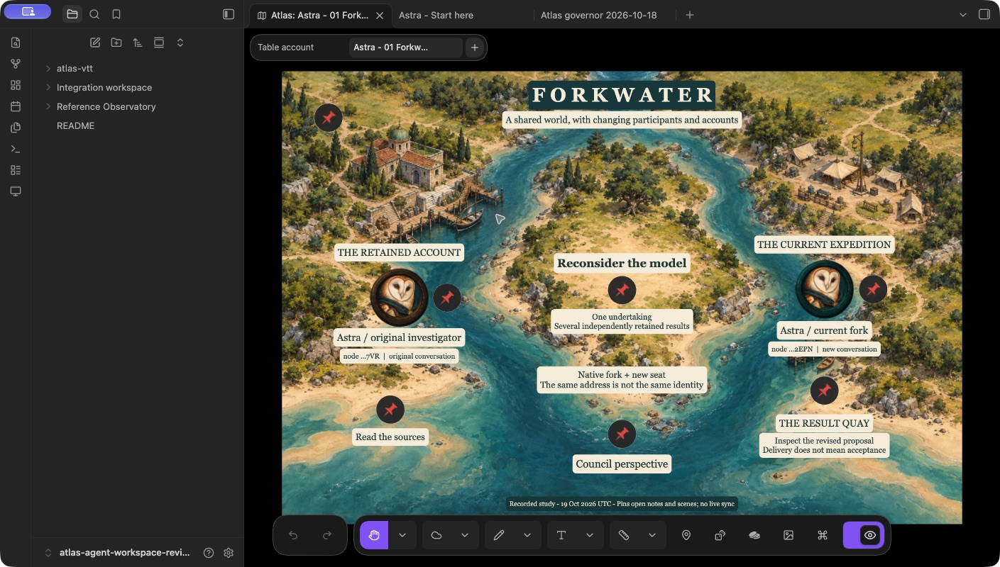
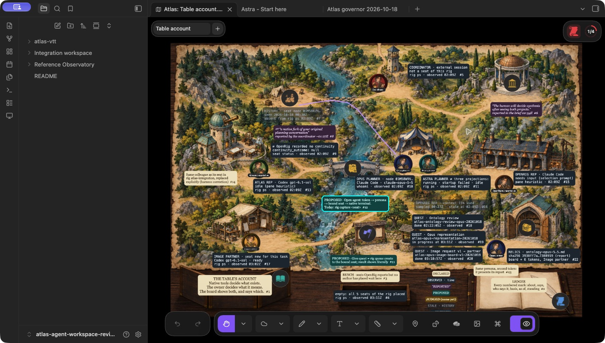

# Two independent Atlas representations

The owner requested two separate projects before deciding how to synthesize a third. Astra and Opus each expressed their own revised model using existing Atlas content. Neither was asked to apply the coordinator's earlier synthesis. This page provides navigation and verification; it selects no common ontology.

| Project | Entry | What to inspect |
| --- | --- | --- |
| [Astra Representation: Forkwater](astra-representation/README.md) | **Astra - 01 Forkwater**, then the Council perspective pin | Similar portraits refer to different historical/current native nodes. In Council, two different contextual appearances refer to one current node and note. Work, results and attributed accounts remain distinct. |
| [Opus Representation: The Table's Account](opus-representation/README.md) | **The Table's Account**, then the table-edge screen and journal pins | A continuing persona has a calling and a history of native seat bindings. Numbered marks connect visible basis labels to a ledger. Quests, relics and judgments have their own meanings. A reconstructed snapshot shows the earlier account. |

Both projects are independent collections in the isolated **atlas-agent-workspace-review** vault. In Atlas's Asset Manager, select the collection and open its entry scene. Their bundles can also be imported into another review vault through **Import collection**:

- [Astra Representation v1](<astra-representation/Astra Representation v1.atlas-collection.zip>)
- [Opus Representation v3](<opus-representation/Opus Representation v3.atlas-collection.zip>)

The meaningful labels, tokens, pins, drawings and notes are editable native content. Generated backgrounds supply the geography. Native observations are dated captures; neither bundle supplies a live resolver, agent launcher or assignment control. Each author explains the existing native route in its notes. OpenRig, Codex and Claude Code continue their own work independently of these scenes.

Opus directed **planning-image-codex@atlas-integration-repos** through an owned OpenRig image task. The Codex partner generated a board and six portraits using its built-in image tool and returned the files and review findings directly to Opus. Opus inspected and accepted them. The [image brief](opus-representation/image-requests/board-v1.md), [image-production record](opus-representation/artwork/README-v1.md) and [Opus provenance](opus-representation/provenance.json) preserve the handoff. The coordinator handled native import and verification, without relaying image prompts or changing either author's representation.

For review, compare how each project answers three questions: what stays the same when a native seat changes; what a visible label actually refers to; and whose evidence or judgment supports that account. The owner will decide whether and how these ideas should meet in a third project. The earlier [ontology synthesis](../ontology-synthesis.md) remains a prior recommendation.

The independently authored reports remain available in full: [Astra](../integration-planning/2026-10-18/ontology-astra.md) and [Opus 5.5](../integration-planning/2026-10-18/ontology-opus-5.5.md). Coordinator native evidence is recorded separately in [verification](independent-representations-evidence/verification.md). Both projects rendered, their note links resolve, and Opus's historical/current snapshot round trip was exercised. Snapshot restoration uses explicit named return points; it cannot be undone.

